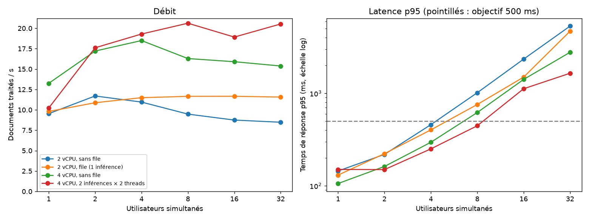

# Journal des itérations

Pour chaque itération du sujet : la mission, ce qu'on a essayé (erreurs comprises), le résultat et
les mesures. Chaque itération terminée porte un tag Git (`git tag`).

---

## Étape 0 — Socle ✅

- Dépôt Git privé sur GitHub, tag `it1-it3` sur l'état initial.
- CI GitHub Actions ([.github/workflows/ci.yml](../.github/workflows/ci.yml)) : `ruff`, `pytest`
  et build des deux images à chaque push. Premier run vert en 1 min 13 s.
- Tests classés en catégories : `ml`, `slow`, `integration` (exclues par défaut).

## Itération 1 — Le Squelette ✅ (tag `it1-it3`)

- **Mission** : API web qui reçoit une image en POST, avec Swagger.
- **Réalisé** : FastAPI, `GET /health`, `POST /v1/classify` (PDF, PNG, JPEG ; 10 Mo max),
  réponses typées avec Pydantic (`packages/core`), Swagger sur `/docs`.
- **Choix** : l'API est **sans état** et ne garde aucun fichier (préparation de l'itération 6).
  C'est le client (Streamlit) qui range les documents.

## Itération 2 — Le Cerveau ✅ (DiT pré-entraîné, puis sonde CLIP retenue sur mesures)

- **Mission** : brancher un modèle Hugging Face et renvoyer une vraie prédiction.
- **Réalisé** : DiT (`microsoft/dit-base-finetuned-rvlcdip`) tourne dans Docker
  (`docker compose -f docker-compose.yml -f docker-compose.ml.yml up -d`). Le tri « simulé »
  (`DOCROUTER_CLASSIFIER=dummy`) reste disponible pour développer le front sans PyTorch.
- **Mesures** (CPU, 4 documents fictifs de `data/samples/`) :

  | Document | Prédiction | Confiance | Label brut DiT | Inférence |
  |---|---|---|---|---|
  | Facture | facture ✅ | 80 % | `invoice` | 132 ms |
  | Bon de livraison | autre ❌ | 98 % | `form` | 161 ms |
  | Ticket de restaurant | autre ❌ | 77 % | `budget` | 127 ms |
  | Courrier de mairie | autre ✅ | 99 % | `letter` | 132 ms |

  Image `docrouter-api:ml` : **1,87 Go** (contre 288 Mo sans IA). RAM du conteneur : **≈ 750 Mo**.
- **Constat** : DiT ne connaît que les 16 classes RVL-CDIP. Seule `invoice` correspond à l'une de
  nos classes : un BL ou un ticket ne peut **jamais** être reconnu, et il est classé « autre » avec
  une forte confiance, donc sans passer par « à vérifier ». Un fine-tuning sur nos 4 classes est
  indispensable.
- **Incident** : le disque C: s'est rempli pendant le build (Docker occupait 60 Go). Résultat : une
  image corrompue (fichiers Python vides) et une distribution WSL `docker-desktop` bloquée.
  Corrections : nettoyage (30 Go de cache de build), mise à jour de WSL, disque Docker déplacé sur
  D:, puis rebuild.

## Données — générateur de documents français ✅

- **Pourquoi** : aucun dataset public ne contient des factures, BL et tickets **français**. Sans
  données étiquetées, on ne peut ni adapter le modèle ni mesurer s'il fonctionne.
- **Réalisé** : paquet `training/`, commande `uv run docrouter-generate`.
  - Contenu fictif cohérent : SIRET valides (clé de Luhn), TVA intracommunautaire calculée,
    HT + TVA = TTC au centime près, taux 20 / 10 / 5,5 %.
  - 4 classes × **4 mises en page** structurellement différentes, et un style (police, couleur,
    tableau) tiré au hasard pour chaque document.
  - Effets **propre / scan** (rotation, papier jauni, bruit, basse résolution) / **photo**
    (perspective, fond, ombre, éclairage inégal). Les tickets sont surtout photographiés.
  - **Gabarit 3 réservé au test** : on mesure si le modèle reconnaît le *type* de document, et
    pas une mise en page déjà vue.
- **Résultat** : 1 320 documents (240 train + 60 val + 30 test par classe) en 2 min sur 11 cœurs,
  254 Mo. `manifest.csv` contient la vérité terrain (utile pour la partie 2) ; `dataset_info.json`
  contient la graine et l'empreinte SHA-256, qui seront enregistrées dans MLflow.
- **Limites** : les documents sont dessinés et restent plus réguliers que des vrais. À compléter
  par des photos de vrais tickets. Les gabarits de test de la facture et du BL partagent une colonne
  latérale : c'est un test difficile et voulu, puisque seul le contenu les distingue.

## Données — banc d'évaluation et comparaison des modèles ✅

- **Pourquoi** : choisir le modèle sur des mesures, avec les mêmes documents et les mêmes métriques
  pour tous, et garder une trace de chaque essai.
- **Réalisé** : `uv run docrouter-evaluate` (groupe `train`) et serveur **MLflow** dans
  `docker-compose.yml` (SQLite + artefacts dans le volume `mlflow-data`). Chaque run enregistre
  l'empreinte du jeu de données et le commit Git. Métriques : accuracy, F1-macro, F1 par classe,
  précision par effet et par format, courbe couverture/précision du seuil « à vérifier »,
  latence p50/p95, taille. Artefacts : matrice de confusion, courbe du seuil, prédictions, tête
  entraînée.
- **Sonde linéaire** : le réseau reste gelé et sert à résumer chaque image en un vecteur ; seule une
  régression logistique à 4 classes est entraînée (sur `train`, régularisation choisie sur `val`).
  Extraction ≈ 3 min par modèle sur CPU, entraînement de la tête < 1 s.
- **Résultats** (120 documents de test, **gabarit jamais vu**, CPU 12 cœurs) :

| Modèle | Accuracy | F1-macro | F1 fact. | F1 NdF | F1 BL | F1 autre | Photo | p50 (ms) | Taille (Mo) |
|---|---|---|---|---|---|---|---|---|---|
| dit-zeroshot (API actuelle) | 35,0 % | 0,227 | 0,37 | 0,00 | 0,00 | 0,54 | 21 % | 185 | 343 |
| clip-zeroshot | 59,2 % | 0,540 | 0,59 | 0,97 | 0,00 | 0,60 | 69 % | 106 | 605 |
| probe-dit | 78,3 % | 0,768 | 0,53 | 0,83 | 0,72 | 0,98 | 79 % | 171 | 343 |
| probe-vit | 72,5 % | 0,704 | 0,31 | 0,97 | 0,61 | 0,93 | 86 % | 174 | 346 |
| **probe-clip** | **97,5 %** | **0,975** | 0,95 | 1,00 | 0,95 | 1,00 | 97 % | **89** | 351 |

- **Constats** :
  - Sans adaptation, aucun modèle n'est utilisable (DiT 35 %, CLIP 59 %, BL jamais reconnu).
  - En validation (gabarits déjà vus), les trois sondes dépassent 99 % : le vrai juge est bien le
    gabarit inédit du test, où DiT et ViT chutent (78 %, 72 %) — ils ont appris les mises en page.
    CLIP généralise (97,5 %) : il a été entraîné sur des images avec du texte, son vecteur capte
    davantage le *contenu*.
  - Les 3 erreurs de probe-clip sont des factures prises pour des BL : exactement la difficulté
    voulue du gabarit de test (colonne latérale commune).
  - probe-clip est aussi le plus rapide (89 ms) ; il ne garde que la partie « image » de CLIP.
  - Seuil : avec probe-clip, 97,5 % des documents passent le seuil actuel (0,6) avec 98,3 % de
    bons rangements.
- **Prudence** : 30 documents par classe (une erreur = 0,8 point), documents synthétiques. Le seuil
  recommandé par le banc est calculé sur le test lui-même, donc optimiste. À confirmer sur
  de vrais documents (`data/test_reel/`).
- **Décision** : **probe-clip** devient le candidat pour l'API ; le fine-tuning complet n'est pas
  nécessaire à ce stade.

## Sonde CLIP branchée dans l'API ✅

- **Réalisé** : `DOCROUTER_CLASSIFIER=probe` (par défaut dans `docker-compose.ml.yml`).
  - L'extracteur d'images (`ImageEmbedder`) et la tête (`LinearHead`) vivent dans l'API ;
    l'entraînement les réutilise, donc les vecteurs de production sont calculés exactement comme
    à l'entraînement.
  - Seule la partie « image » de CLIP est chargée.
  - La tête (14 Ko) est en `.npz` **sans pickle** : elle ne peut pas contenir de code, et l'API
    n'a pas besoin de scikit-learn. Elle est montée depuis `models/probes/`, ou téléchargée
    depuis le Hub avec `hf://…`.
  - **Échauffement au démarrage** : la 1re inférence PyTorch coûtait 11 s sur la 1re requête.
- **Vérification de bout en bout** : les 120 documents de test envoyés à l'API conteneurisée
  donnent 117/120 corrects, soit les mêmes 3 erreurs que le banc (factures → BL, dont une
  envoyée dans `a_verifier`).
  - Latence par requête : p50 113 ms, p95 176 ms ; modèle seul : p50 84 ms.
  - RAM du conteneur : 1,16 Go (contre ≈ 750 Mo avec DiT). Image : 1,87 Go, inchangée.
  - Rangement : 30 autres, 31 BL, 26 factures, 30 notes de frais, 3 `a_verifier`.

## Itération 3 — L'Isolement ✅ (tag `it1-it3`)

- **Mission** : Dockerfile optimisé.
- **Réalisé** : Dockerfiles multi-stage avec uv, utilisateur non-root, healthchecks,
  `docker-compose.yml` (API + front).
- **Erreur et correction** : le premier build durait plus de 50 min pour environ 2 Go d'images.
  Cause : PyTorch (814 Mo) et PyMuPDF, qui tirait onnxruntime. Solution : IA en option
  (`WITH_ML=true`) et passage à pypdfium2. Résultat : API 288 Mo, front 858 Mo, build en environ 8 min.

## Itération 4 — L'Optimisation ✅

- **Objectif** : un modèle plus léger et plus rapide, sans perdre en précision.
- **Réalisé** :
  - `uv run docrouter-export-onnx` : export de la partie « image » de CLIP en ONNX (`torch.onnx`),
    puis quantization dynamique INT8 (`onnxruntime.quantization`). Vérifications automatiques :
    prétraitement numpy identique à Hugging Face (écart 5e-7), ONNX fp32 identique à PyTorch.
  - L'API exécute le réseau avec **onnxruntime** et refait le prétraitement en PIL + numpy :
    **plus de PyTorch ni de transformers** dans l'image de production (`ML_EXTRA=onnx`).
  - Le fichier ONNX et la tête doivent venir du même modèle d'origine (`export_info.json`),
    sinon l'API refuse de démarrer le classifieur.
- **Choix de la quantization**, mesuré dans le banc (MLflow) :

| Variante | Accuracy | Modèle (p50) | Fichier |
|---|---|---|---|
| PyTorch (référence) | 97,5 % | 89 ms | 351 Mo |
| ONNX fp32 | 97,5 % | 66 ms | 353 Mo |
| ONNX INT8 par défaut | 90,8 % ❌ | 64 ms | 90 Mo |
| ONNX INT8 per_channel seul | 25 % ❌ (cassé) | — | 90 Mo |
| **ONNX INT8 per_channel + reduce_range** | **97,5 %** | **60 ms** | **90 Mo** |

  Sur les CPU x86 sans instructions VNNI, les produits 8 bits × 8 bits saturent : il faut
  réduire la plage des poids à 7 bits (`reduce_range`). Une échelle par canal (`per_channel`)
  limite ensuite la perte de précision. Avec INT8, 3 erreurs comme en PyTorch, dont une
  différente, et une confiance qui varie de 0,05 en moyenne.
- **Lourd vs optimisé, dans le conteneur** (120 documents envoyés à l'API, mêmes conditions) :

| | PyTorch | **ONNX INT8** |
|---|---|---|
| Image Docker | 1,87 Go | **538 Mo** (−71 %) |
| RAM du conteneur | 504 Mo | **231 Mo** (−54 %) |
| Démarrage jusqu'à « prêt » | 24 s | **4 s** |
| Modèle p50 / p95 | 86 / 109 ms | **54 / 78 ms** |
| Requête complète p50 / p95 | 117 / 160 ms | **87 / 123 ms** |
| Bien triés | 117/120 | 117/120 |

  Critères du plan respectés : écart d'accuracy ≤ 2 points (0), latence ≤ 500 ms.
- **Reste** : publier la tête et le modèle ONNX sur le Hub Hugging Face (privé) pour que l'image
  n'ait plus besoin du dossier `models/` local.
## Itération 5 — Le Flux ✅

- **Objectif** : simuler un afflux continu de documents vers l'API et mesurer sa résistance.
- **Réalisé** :
  - `load_test/locustfile.py` (Locust) : des utilisateurs virtuels envoient en boucle, sans
    pause, des documents du jeu de test (JPEG, PDF, photos), avec la clé d'API. La charge monte
    par paliers (1, 2, 4, 8, 16, 32 utilisateurs, 30 s chacun) ; chaque requête est enregistrée.
  - `uv run docrouter-load-report` : débit, latence p50/p95/p99, erreurs et précision par
    palier, graphiques, et un run MLflow par campagne (expérience `docrouter-load`).
  - `docker-compose.load.yml` : l'API est bridée à 2 ou 4 vCPU, comme un petit serveur cloud,
    pour obtenir des chiffres par vCPU utiles au budget (itération 9). Sinon elle utiliserait
    les 12 cœurs du PC, partagés avec Locust.
- **Problème trouvé, puis corrigé** : sous forte charge, le débit **baissait** (2 vCPU : 11,7 →
  8,5 doc/s à 32 utilisateurs). Toutes les inférences tournaient en même temps et se disputaient
  les cœurs. Correctif : une **file d'attente** limite les inférences simultanées
  (`DOCROUTER_MAX_CONCURRENT_INFERENCES`), et le nombre de threads d'onnxruntime est réglable
  (`DOCROUTER_ONNX_THREADS`). Le décodage des images reste parallèle.
- **Réglage, mesuré** : 2 threads par inférence, une inférence simultanée par paire de vCPU.

| Configuration | Débit max | Débit à 32 utilisateurs | Charge tenue avec p95 ≤ 500 ms | p95 à 32 utilisateurs |
|---|---|---|---|---|
| 2 vCPU, sans file | 11,7 doc/s | 8,5 doc/s | 4 utilisateurs | 5,3 s |
| **2 vCPU, file (1 inférence × 2 threads)** | **11,7 doc/s** | **11,6 doc/s** | 4 utilisateurs | 4,7 s |
| 4 vCPU, sans file | 18,5 doc/s | 15,4 doc/s | 4 utilisateurs | 2,8 s |
| 4 vCPU, file (1 inférence × 4 threads) | 15,9 doc/s | 14,9 doc/s | 2 utilisateurs | 2,7 s |
| **4 vCPU, file (2 inférences × 2 threads)** | **20,6 doc/s** | **20,5 doc/s** | **8 utilisateurs** | **1,6 s** |

- **Constats** :
  - **Aucune erreur** sur ≈ 9 000 requêtes, même à 32 utilisateurs : au-delà de la capacité,
    l'API fait attendre au lieu de tomber.
  - La précision reste de 95 à 99 % sous charge (tirage aléatoire parmi les 120 documents de
    test, 97,5 % au total).
  - Le débit plafonne à ≈ 5,5 doc/s par vCPU : c'est la base du calcul FinOps.
  - RAM sous charge : 620 à 850 Mo (documents décodés en mémoire), pour une limite de 2 Go.
  - 1 million d'images par mois, c'est en moyenne 0,4 doc/s : un seul conteneur à 2 vCPU
    (≈ 11,5 doc/s) a une marge d'environ ×30, même avec des pics.
- **Limites** : Locust tourne sur la même machine que l'API (les vCPU de l'API sont réservés
  par Docker, mais le réseau est local). Le dossier surveillé et la boucle de rétroaction
  prévus au plan ne sont pas réalisés (facultatifs).
## Itération 6 — La Barrière ✅

- **Pourquoi, alors que nos données sont fictives** : le sujet vise le produit. En usage réel,
  l'API recevrait de vraies factures et notes de frais (noms, adresses, montants, parfois des
  numéros de carte). Les données fictives sont justement une mesure RGPD pour le développement.
- **Authentification** : une clé d'API par client (`DOCROUTER_API_KEYS="front:…,compta:…"`),
  en-tête `X-API-Key` sur `/v1/*`.
  - Le client est identifié dans les journaux, et révocable seul.
  - L'API est fermée si aucune clé n'est configurée (503) ; les clés de moins de 24 caractères
    sont refusées au démarrage.
  - Comparaison en temps constant ; clés uniquement dans `.env`.
  - Bouton « Authorize » dans Swagger ; le front envoie sa clé.
- **Aucune image conservée** :
  - **Trouvé en route** : Starlette écrit sur disque (fichier temporaire) tout fichier reçu de
    plus de 1 Mo, ce qui est le cas de la plupart des scans. Le seuil est relevé à la taille
    maximale autorisée : le document reste en mémoire. Un test le prouve (il échoue si on
    retire le correctif).
  - La clé et la taille sont contrôlées **avant** la lecture du document (middleware).
  - Conteneur de l'API en lecture seule, `/tmp` en mémoire, aucun privilège Linux : une
    tentative d'écriture échoue (`Read-only file system`, vérifié dans le conteneur).
  - Journaux limités aux métadonnées, sans nom de fichier ni clé (testé).
- **Vérifié dans les conteneurs** : sans clé ou avec une mauvaise clé → 401 ; avec la clé du
  front → classé ; 117/120 sur le jeu de test, comme avant. Le premier décodage JPEG/PDF prenait
  1,5 s : il est désormais fait pendant l'échauffement au démarrage.
- **Tests** : 13 nouveaux (`tests/test_security.py`), 89 au total.
- **Hors périmètre** : HTTPS. Il est assuré en production par un reverse proxy ou le service
  cloud, et l'itération 7 n'est pas réalisée (consigne).
## Itération 7 — Le Grand Saut ⏳
## Itération 8 — Le Rétroviseur ⏳
## Itération 9 — La Facture ⏳
